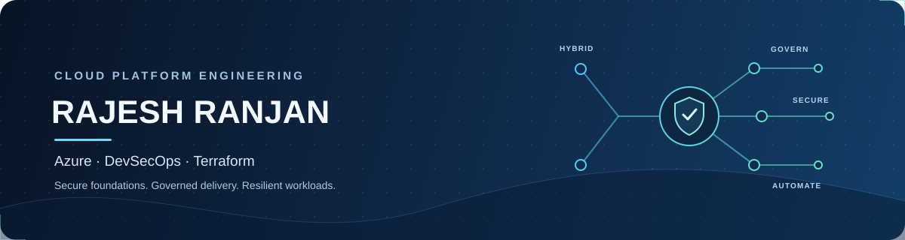

### DevSecOps Engineer · Azure Cloud Platform · Infrastructure as Code

**Building secure, governed, resilient, and cost-aware cloud foundations across Azure, on-premises datacenters, and hybrid workloads.**

---

## 👋 About me

I’m **Rajesh Ranjan**, a **DevSecOps Engineer** with **5 years of experience**. I focus on designing and automating secure Azure platform foundations and delivery workflows—from tenant governance and identity to networking, CI/CD, container platforms, operations, and cost management.

My approach is practical: establish clear guardrails, automate repeatable platform patterns, and build for the needs of both cloud and on-premises workloads.

## 🧭 Cloud platform & landing zones

I work across the cloud adoption lifecycle—**Strategy, Plan, Ready, Adopt, Govern, Secure, and Manage**—to support scalable and well-governed environments.

- **Tenant and subscription design:** tenant boundaries, management group hierarchy, platform and application subscriptions, and subscription onboarding/offboarding.
- **Governance:** Azure Policy and initiatives, assignment strategy, justified policy exemptions, and management group best practices.
- **Identity and access:** Microsoft Entra ID, user and group management, RBAC group design, least privilege, and Defender.
- **Operational foundations:** scalable, portable, highly available, monitored, backed-up, compliant, and cost-optimised workloads.

## 🌐 Networking & hybrid connectivity

- Hub-and-spoke architecture with shared connectivity and centralized inspection.
- IP address management, CIDR planning, and on-premises network assessment.
- Hub and spoke VNets, peering, user-defined routes, firewall rules, and controlled egress.
- Private DNS zones, Private Endpoints, VPN Gateway, and ExpressRoute.

## 🔐 DevSecOps & Terraform automation

- Reusable Terraform modules and automated Azure landing zone deployments.
- Remote state with encryption at rest and least-privilege access.
- CI/CD with GitHub Actions and Azure DevOps for validation, testing, build, deployment, apply, and rollback.
- Docker container workflows and Kubernetes orchestration, with Helm charts for repeatable application deployments.
- GitOps delivery patterns using Argo CD to keep deployed environments aligned with version-controlled configuration.
- Branch policies, mandatory pull requests, code owners, reviewer requirements, and short-lived feature branches.
- Pipeline practices including linting, secret scanning, cost checks, drift detection, manual approvals, and parallel jobs.

## 🚚 Cloud migration

Planning and delivery support across discovery, assessment, readiness, migration strategy, cutover, and hypercare—with **pre-migration, in-flight, and post-migration checklists**.

## 💰 FinOps, resilience & operations

| Focus | Practices |
|---|---|
| **Cost optimisation** | Find idle resources, unattached disks, oversized compute, and unnecessary log ingestion; review VM schedules, reserved capacity, and backup retention. |
| **Backup & disaster recovery** | Select appropriate LRS, ZRS, or GRS options; define recovery plans around RTO and RPO. |
| **High availability** | Plan primary and secondary regions and use patterns such as Virtual Machine Scale Sets (VMSS) where appropriate. |
| **Monitoring** | Use Azure Monitor to support visibility, alerting, and operational follow-through. |

## 🤖 Applied AI

Exploring practical AI alongside cloud engineering: **LLM-powered workflows, retrieval-augmented generation (RAG), Model Context Protocol (MCP), and AI agents**—with an emphasis on useful, responsible applications for engineering and operations.

## 🧰 Core areas

`Microsoft Azure` · `Azure Landing Zones` · `Azure Policy` · `Microsoft Entra ID` · `RBAC` · `Hub-and-Spoke Networking` · `Terraform` · `GitHub Actions` · `Azure DevOps` · `Docker` · `Kubernetes` · `Argo CD` · `GitOps` · `Helm` · `Cloud Migration` · `FinOps` · `Azure Monitor` · `Backup & Disaster Recovery` · `LLMs` · `RAG` · `MCP` · `AI Agents`

---

### Let’s connect

Open to conversations about **Azure platform engineering, landing zones, cloud governance, DevSecOps, and hybrid cloud**.

[GitHub](https://github.com/RajeshR-code)

